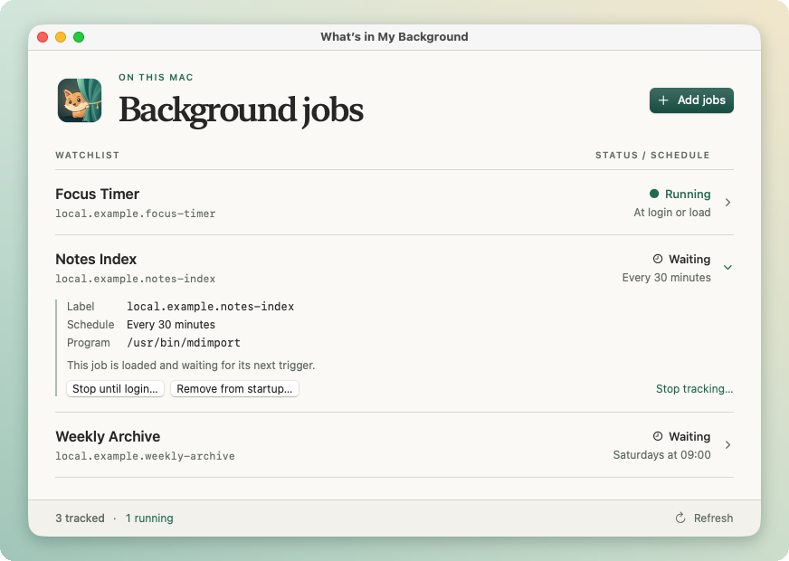

<p align="center">
  
</p>

<h1 align="center">What’s in My Background</h1>

<p align="center">A Mac watchlist for the background jobs you maintain.</p>

<p align="center">
  <a href="#build-and-open">Build and open</a> &nbsp;·&nbsp;
  <a href="#manage-a-job">Manage a job</a> &nbsp;·&nbsp;
  <a href="#safeguards">Safeguards</a>
</p>

<p align="center">
  <picture>
    <source media="(prefers-color-scheme: dark)" srcset="docs/images/watchlist-dark.png">
    
  </picture>
</p>

That script you set up months ago: is it still running, or just waiting for its next scheduled run? Add its LaunchAgent to your watchlist to see its status and schedule. Expand the row when you want to make a change. Apps’ helpers stay out of the list unless you choose them.

## Build and open

You need **macOS 14 or later** and the **Xcode Command Line Tools**. If the tools aren’t installed, run `xcode-select --install` first.

```sh
git clone https://github.com/GitAashishG/whats-in-my-background.git
cd whats-in-my-background
bash scripts/build-app.sh
open 'dist/What’s in My Background.app'
```

For everyday use, drag the app from `dist` to `~/Applications`. The build is ad-hoc signed for local use, not notarized for distribution. The app runs without `sudo`, a network connection, or a background helper of its own.

## Manage a job

Choose **Add jobs** and select a label you recognize from `~/Library/LaunchAgents`. Adding a job starts tracking it; it doesn’t start the process. A job marked **Waiting** is loaded and ready for its next trigger.

| Action | What happens |
| :--- | :--- |
| **Stop until login** | Unloads the job and pauses scheduled runs. Its startup file stays in place for your next login. Use **Load now** to bring it back sooner. |
| **Remove from startup** | Unloads the job and archives its startup file. The script, its settings outside the plist, and its logs stay where they are. |
| **Restore startup** | Returns the archived plist to `~/Library/LaunchAgents` and loads the job. Its schedule determines whether it runs immediately. |
| **Stop tracking** | Removes the row from the watchlist without changing the job. |

Press **⌘R** to refresh. The window also refreshes when it becomes active and every 15 seconds while you use it.

## Safeguards

The app manages user-owned LaunchAgent files installed directly in your login account. System daemons, cron jobs, and other users’ processes are outside its scope. Archiving uses `~/Library/Application Support/WhatsInMyBackground/Removed Startup Items/`. Restoring won’t overwrite a new startup file with the same name.

Run `bash scripts/test-guards.sh` to check how the app handles an untracked label, a conflicting archive, and a substituted symlink. The test uses a disposable directory and doesn’t load or stop any services.
